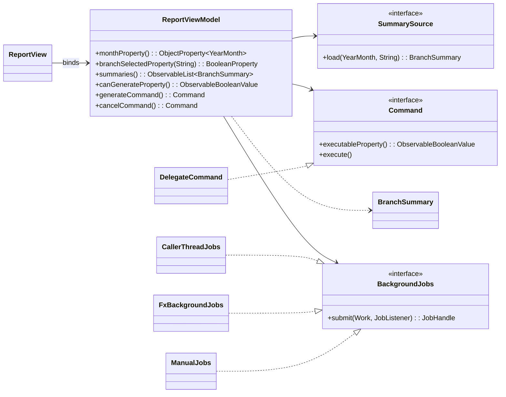
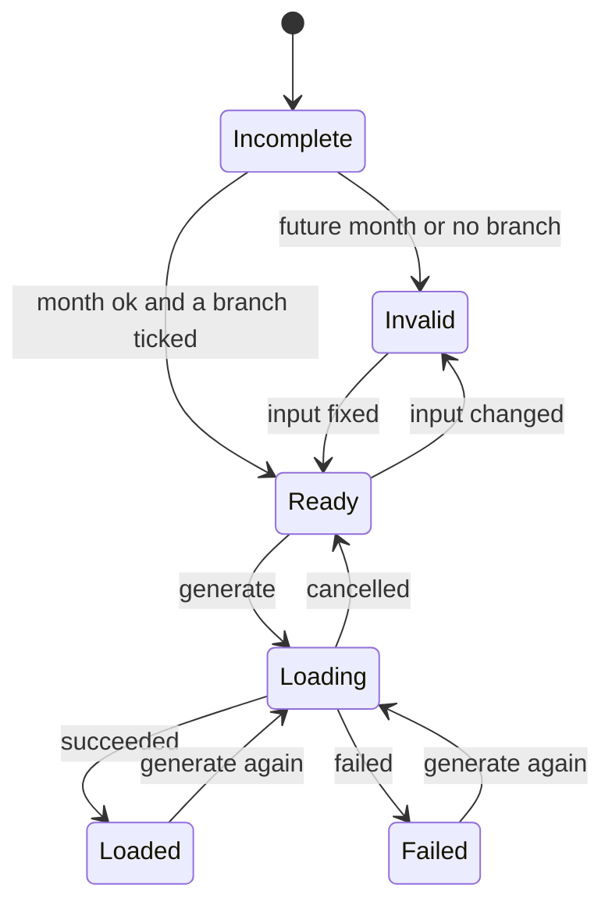

# Lab-03: ReportViewModel Design Document

## 1. Inventory of Lab-02 ReportController

The table below breaks down every control interaction, condition, and operation from the Lab-02 `ReportController` (Starter B), identifying its concern and assigning its new owner in MVVM:

| Code / Operation                                             | Concern                                  | New Owner                            | Rationale                                                                           |
| :----------------------------------------------------------- | :--------------------------------------- | :----------------------------------- | :---------------------------------------------------------------------------------- |
| `month.getValue()`                                         | User input (selected month)              | **ViewModel**                  | Exposed as `monthProperty()` (`ObjectProperty<YearMonth>`) for two-way binding. |
| `if (m == null)`                                           | Validation logic                         | **ViewModel**                  | Evaluated reactively in `monthError` and `canGenerate` bindings.                |
| `status.setText("Choose a month.")`                        | Presentation state / validation feedback | **ViewModel**                  | Represented by `statusProperty()` and `validationMessageProperty()`.            |
| `box.isSelected()`                                         | User input (branch toggle)               | **ViewModel**                  | Exposed per branch via `branchSelectedProperty(branch)` (`BooleanProperty`).    |
| `if (box.isSelected())`                                    | Input filtering / selection check        | **ViewModel**                  | Managed in `selectedBranches()` query on the branch selection properties.         |
| `box.getText()`                                            | Branch identifier reference              | **ViewModel** / **View** | Constant branch keys defined in `ReportViewModel.BRANCHES`.                       |
| `engine.summarizeBranch(m, branch, dataDir)`               | Sales calculations & data retrieval      | **Model**                      | Model concern decoupled through the `SummarySource` port interface.               |
| `new ArrayList<>()` / thread execution                     | Execution model & threading              | **ViewModel** / **Port** | Offloaded from FX Application Thread to `BackgroundJobs` port.                    |
| `catch (IOException e)`                                    | Error handling                           | **ViewModel**                  | Handled in `JobListener.failed()` callback, updating `loadErrorProperty()`.     |
| `status.setText("Load failed: " + e.getMessage())`         | Error presentation                       | **ViewModel**                  | Exposed to the view via `loadErrorProperty()` and `statusProperty()`.           |
| `table.getItems().setAll(rows)`                            | Displaying summary data                  | **View** / **ViewModel** | ViewModel exposes `summaries()`; View binds `TableView.itemsProperty()`.        |
| `status.setText("Loaded " + rows.size() + " branch(es).")` | Completion feedback message              | **ViewModel**                  | Formatted and updated in `statusProperty()` upon successful load.                 |

---

## 2. ViewModel Members Specification

The members of `ReportViewModel` are structured into input, output, computed properties, and commands:

### Input State (View May Write)

| Member                | Type                          | View May Write? | Description                                                                |
| :-------------------- | :---------------------------- | :-------------: | :------------------------------------------------------------------------- |
| `month`             | `ObjectProperty<YearMonth>` |  **Yes**  | Selected year and month (two-way bound to ComboBox or DatePicker).         |
| `branchSelected(b)` | `BooleanProperty`           |  **Yes**  | Toggle selection state for branch `b` (two-way bound to CheckBox).       |
| `productFilter`     | `StringProperty`            |  **Yes**  | Query text to filter visible products (two-way bound to search TextField). |

### Output State (View May NOT Write)

| Member              | Exposed Type                                     | View May Write? | Description                                                                      |
| :------------------ | :----------------------------------------------- | :-------------: | :------------------------------------------------------------------------------- |
| `monthChoices`    | `ObservableList<YearMonth>` (unmodifiable)     |  **No**  | List of choices for the last 12 months.                                          |
| `summaries`       | `ObservableList<BranchSummary>` (unmodifiable) |  **No**  | Branch summaries loaded for the selected month and branches.                     |
| `visibleProducts` | `FilteredList<ProductTotal>`                   |  **No**  | Top products matching the current `productFilter`.                             |
| `loading`         | `ReadOnlyBooleanProperty`                      |  **No**  | `true` while a background loading task is running.                             |
| `progress`        | `ReadOnlyDoubleProperty`                       |  **No**  | Fractional loading progress from `0.0` to `1.0`.                             |
| `status`          | `ReadOnlyStringProperty`                       |  **No**  | High-level status text (e.g. *"Choose a month."*, *"Loaded 3 branch(es)."*). |
| `loadError`       | `ReadOnlyStringProperty`                       |  **No**  | Error description if data loading fails; empty otherwise.                        |

### Computed State (Reactive Bindings, View May NOT Write)

| Member                | Exposed Type                          | View May Write? | Description                                                                   |
| :-------------------- | :------------------------------------ | :-------------: | :---------------------------------------------------------------------------- |
| `monthError`        | `StringExpression`                  |  **No**  | Error string if month is missing or in the future.                            |
| `branchError`       | `StringExpression`                  |  **No**  | Error string if no branches are selected (*"Select at least one branch."*). |
| `validationMessage` | `StringExpression`                  |  **No**  | Combined validation string (`monthError` or `branchError`).               |
| `canGenerate`       | `ObservableBooleanValue`            |  **No**  | `true` when input is valid and `loading` is false.                        |
| `totalRevenue`      | `ObservableObjectValue<BigDecimal>` |  **No**  | Sum of revenue across all loaded summaries.                                   |
| `totalRevenueText`  | `StringExpression`                  |  **No**  | Formatted chain revenue string (e.g. `"USD 12,345.60"`).                    |

### Commands (Executable Actions)

| Member              | Exposed Type | View May Trigger? | Description                                                                         |
| :------------------ | :----------- | :---------------: | :---------------------------------------------------------------------------------- |
| `generateCommand` | `Command`  |   **Yes**   | Executes report generation on background worker thread. Guarded by `canGenerate`. |
| `cancelCommand`   | `Command`  |   **Yes**   | Cancels active background generation task. Guarded by `loading`.                  |

---

## 3. Ports and Interfaces

To isolate the ViewModel from the UI framework (JavaFX scenes/stages) and concrete infrastructure (filesystems and threads), two primary ports and command interfaces are established:

1. **`SummarySource` (Model Port)**:
   ```java
   @FunctionalInterface
   public interface SummarySource {
       BranchSummary load(YearMonth month, String branch) throws Exception;
   }
   ```
2. **`BackgroundJobs` (Threading Port)**:
   Decouples concurrency from the JavaFX `Task`/`Service` thread model. Supplies worker execution and guarantees that `JobListener` callbacks arrive on the UI thread.
3. **`Command` & `DelegateCommand`**:
   Exposes executable actions guarded by `ObservableBooleanValue` to control button enablement declaratively.

---

## 4. Class Diagram



---

## 5. UI Independence Verification

`ReportViewModel` is completely decoupled from the JavaFX UI scene graph (`javafx.scene`, `javafx.stage`):

* `grep -n "^import javafx" src/main/java/edu/itc/salesreport/ui/ReportViewModel.java` imports only:
  - `javafx.beans.*`
  - `javafx.collections.*`
* Build and compilation check passes cleanly without starting JavaFX:
  ```bash
  mvn -q compile
  ```

---

## 6. Screen State Machine

### State Diagram (`stateDiagram-v2`)



### Property Values per State

| State                | `month`                         | `branchSelected` | `monthError`                              | `branchError`                             | `validationMessage` | `canGenerate` | `loading` |    `progress`    | `status`                             | `loadError`     | `summaries`       |
| :------------------- | :-------------------------------- | :----------------- | :------------------------------------------ | :------------------------------------------ | :-------------------- | :-------------: | :---------: | :----------------: | :------------------------------------- | :---------------- | :------------------ |
| **Incomplete** | `null`                          | At least 1 ticked  | `"Choose a month."`                       | `""`                                      | `"Choose a month."` |    `false`    |  `false`  |      `0.0`      | `"Choose a month."`                  | `""`            | Empty (or previous) |
| **Invalid**    | Future month or unselected branch | Future or 0 ticked | `"Month ... is in the future."` or `""` | `"Select at least one branch."` or `""` | Non-empty message     |    `false`    |  `false`  |      Previous      | Previous                               | Previous          | Previous kept       |
| **Ready**      | Valid month ($\le$ today)       | At least 1 ticked  | `""`                                      | `""`                                      | `""`                |    `true`    |  `false`  |      Previous      | Previous                               | Previous          | Previous            |
| **Loading**    | Valid month                       | At least 1 ticked  | `""`                                      | `""`                                      | `""`                |    `false`    |  `true`  | `0.0` .. `1.0` | `"Loading..."`                       | `""`            | Previous kept       |
| **Loaded**     | Valid month                       | At least 1 ticked  | `""`                                      | `""`                                      | `""`                |    `true`    |  `false`  |      `1.0`      | `"Loaded N branch(es) for YYYY-MM."` | `""`            | Populated summaries |
| **Failed**     | Valid month                       | At least 1 ticked  | `""`                                      | `""`                                      | `""`                |    `true`    |  `false`  |     Fractional     | `"Load failed, previous data kept."` | Exception message | Previous kept       |
